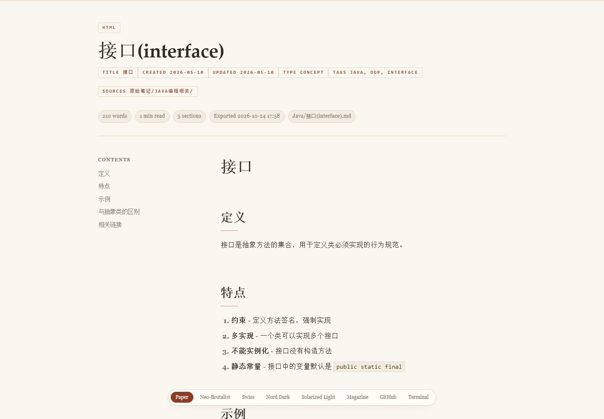
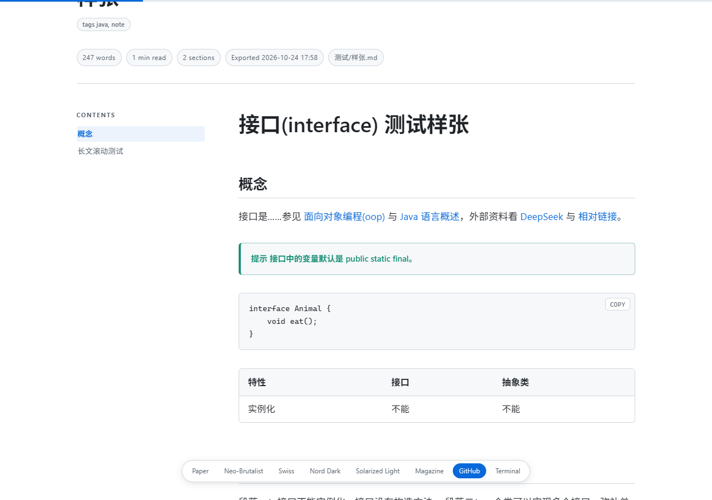

# Typeset Live

> 不用离开 Obsidian——当前笔记的网页效果，开一个标签页就能看。

一个 Obsidian 插件。左侧点一下地球图标（或命令面板运行「打开当前笔记的网页预览」），当前笔记立刻以排版精致的网页形式出现在 Obsidian 的一个标签页里：8 套主题随时切换、边写边自动刷新、内链点了就能跳。不开浏览器、不写文件。



---

## 它解决什么问题

[Typeset](https://github.com/Fogecode/Typeset) 已经能把笔记变成一份好看的独立 HTML 文件，但「写作过程中想看看网页效果」时，每次都要导出、再开浏览器、来回切窗口。

Typeset Live 把同一套渲染直接放进 Obsidian：**所见即所得，写完再导出**。写笔记的人停在 Obsidian 里就够了。

---

## 功能

- **标签页预览**：渲染结果显示在 Obsidian 标签页中，可拖拽分栏，和普通笔记并排
- **8 套主题**：Paper / Neo-Brutalist / Swiss / Nord Dark / Solarized / Magazine / GitHub / Terminal，工具栏即时切换，不重载页面
- **跟随当前笔记**：切到哪篇，预览自动跟着渲染哪篇（可关）
- **编辑实时刷新**：改笔记 600ms 后自动重渲染，并保持滚动位置（可关）
- **内链跳转**：预览里点双链或相对 .md 链接，直接在 Obsidian 打开对应笔记；外部链接走系统浏览器
- **代码复制**：预览里的复制按钮经 Obsidian 宿主剪贴板，沙箱内同样可用
- **手机宽度模拟**：一键把预览收窄到 390px 检查响应式效果

### 主题速览




---

## 安装

### 手动安装

1. 下载本仓库（Code → Download ZIP 或 git clone）
2. 把仓库根目录的 main.js、manifest.json、styles.css 放进你的仓库 .obsidian/plugins/typeset-live/ 文件夹（没有就新建）
3. 重启 Obsidian，设置 → 第三方插件 → 开启 **Typeset Live**

### 从源码构建

```bash
npm install
npm run build   # 产出 main.js
```

---

## 命令

| 命令 | 作用 |
| --- | --- |
| 打开当前笔记的网页预览 | 在新标签页打开/激活预览并渲染当前笔记（左侧缎带地球图标同效） |
| 刷新网页预览 | 立即重新渲染当前预览 |
| 切换「跟随当前笔记」 | 开/关跟随模式 |

## 设置

- 主题：预览默认风格（页面内可随时换）
- 跟随当前笔记 / 编辑实时刷新：两个自动化行为的开关
- 内嵌图片：把仓库图片以 base64 内嵌，与 Typeset 导出效果一致
- 页面功能：目录侧栏、页面内主题切换器、阅读进度条、代码复制按钮、回到顶部

---

## 与 Typeset 的关系

姊妹插件，同一套渲染管线：**Typeset 负责导出文件，Typeset Live 负责原地预览**。两者互不依赖，可以只装一个，也可以同时安装。

## 兼容性

- Obsidian >= 1.4.0，桌面端与移动端均可用
- 渲染完全本地进行，零网络请求，不读写笔记以外的文件

## 开发

```bash
npm run typecheck   # tsc --noEmit
npm run build       # main.js + data/test-bundle.cjs（验证用，gitignored）
```

scripts/ 下是验证工具链（本机自测用，依赖本地 Obsidian 仓库与 Chrome）：mock-obsidian 离线加载模拟、verify-plugin / verify-bridge / verify-realnote 三套断言（23 + 14 + 9 项）、install-vault.ps1 一键装机（自动备份启用清单）。

## 许可

[MIT](LICENSE) · 第三方组件见 [THIRD-PARTY-NOTICES.md](THIRD-PARTY-NOTICES.md)
